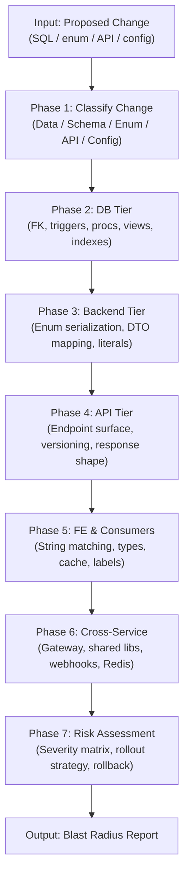

<div align="center">

# 🎯 lz-change-impact-analysis

**Proactive blast radius assessment for enterprise microservice changes**

[](https://opensource.org/licenses/MIT)
[](https://agentskills.io/specification)
[](./references/research-foundations.md)

</div>

---

## What It Does

Predicts **what will break** before a change is deployed — tracing impact across 8 layers: database constraints → backend enums/DTOs → API endpoints → frontend consumers → shared middleware → caches → webhooks → cross-service dependencies.

Unlike documentation skills (descriptive) or debugging skills (reactive), this skill is **predictive**: it maps the blast radius of a proposed change before it reaches production.

## How It Works



## The Research

This skill is grounded in academic research and enterprise best practices:

| Source | Year | Key Finding | Impact on Skill Design |
|--------|------|-------------|----------------------|
| Lelovic et al. — *J. Systems & Software* | 2025 | First SLR on CIA for microservices; cross-service analysis is an open gap | Validates multi-tier approach |
| Cerny et al. — *arXiv:2501.11778* | 2025 | ISAR framework: delta-based conflict detection across services | Inspired Phase 3-6 conflict rules |
| Maule — *UCL PhD / ICSE* | 2008 | Manual expert predictions frequently incorrect; automated analysis needed | Justifies DB dependency scanning |
| Xavier et al. — *SANER* | 2017 | 14.78% of API changes break consumers; frequency increases over time | Justifies mandatory FE tier analysis |
| Lehnert et al. — *J. Systems & Software* | 2021 | CIA taxonomy: static + dynamic + historical hybrid is most effective | Shaped our hybrid approach |

Full citations and methodology details: [`./references/research-foundations.md`](./references/research-foundations.md)

## Role-Specific Playbooks

The skill includes tailored checklists for 5 senior engineering roles:

| Role | Focus | Playbook |
|------|-------|----------|
| 🗄️ **Senior DBA** | Schema deps, Expand-Contract, rollback safety | [`role-playbooks.md#senior-dba`](./references/role-playbooks.md) |
| ⚙️ **Senior Backend** | Enum serialization, DTO coupling, contract stability | [`role-playbooks.md#senior-backend`](./references/role-playbooks.md) |
| 🖥️ **Senior Frontend** | String matching audit, type sync, cache invalidation | [`role-playbooks.md#senior-frontend`](./references/role-playbooks.md) |
| 🔒 **DevSecOps** | CI/CD gates, ITIL CAB, deploy sequencing | [`role-playbooks.md#devsecops`](./references/role-playbooks.md) |
| 🌉 **Senior Fullstack** | Cross-tier matrix, coordination, verification | [`role-playbooks.md#senior-fullstack`](./references/role-playbooks.md) |

## Installation

```bash
npx skills add lutfi-zain/lz-stacks --skill lz-change-impact-analysis
```

## Usage

```
/skill:lz-change-impact-analysis

# Example prompts:
"impact analysis of changing PaymentMode.Name from 'E-Payment' to 'Digital Payment'"
"blast radius of dropping the is_active column from users table"
"what will break if I rename this enum value"
"trace downstream dependencies of changing this API response field"
```

## File Structure

```
lz-change-impact-analysis/
├── SKILL.md                              # Core skill definition (8-phase process)
├── README.md                             # This file
├── references/
│   ├── research-foundations.md           # 9 academic papers + industry standards
│   └── role-playbooks.md                # Per-role checklists (DBA/BE/FE/DevSecOps/Fullstack)
└── assets/
    └── blast-radius-template.md          # Output template for blast radius reports
```

## Differentiation

| Skill | Purpose | Lifecycle Phase |
|-------|---------|----------------|
| `lz-tech-doc-architect` | *"How is this system designed?"* | Documentation (descriptive) |
| `lz-kairos-debugger` | *"What caused this incident?"* | Post-incident (reactive) |
| `lz-pr-review` | *"Is this code change good quality?"* | Code review (evaluative) |
| **`lz-change-impact-analysis`** | ***"What will break if I make this change?"*** | **Pre-flight (predictive)** |

---

<div align="center">
Built with 🎯 by <a href="https://github.com/lutfi-zain">Lutfi Zain</a>
</div>
