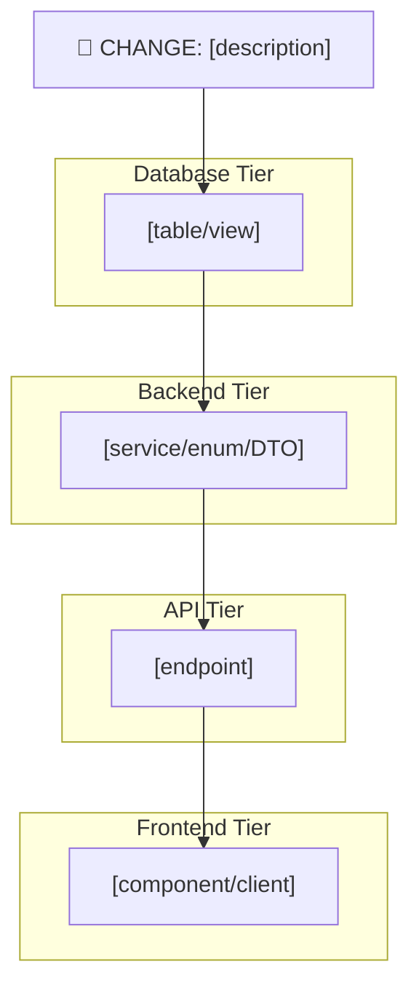

# Blast Radius Report: [Change Description]

> **Date**: [YYYY-MM-DD]
> **Author**: [Agent / Human]
> **Target Service**: [Primary service where change originates]
> **Environment**: [dev / staging / preprod / prod]
> **Risk Level**: [🟢 Low / 🟡 Medium / 🔴 High / 🔴 Critical]

---

## 1. Change Classification

| Attribute | Value |
|-----------|-------|
| **Change Type** | [Data Mutation / Schema DDL / Code Enum / API Contract / Config] |
| **Change Statement** | `[exact SQL / code diff / description]` |
| **Reversible** | [Yes — reverse UPDATE / No — data lost / Conditional] |
| **Backward Compatible** | [Yes / No / With dual-write] |

---

## 2. Layer-by-Layer Impact Matrix

### Layer 1-2: Database & Data Tier

| Object | Type | Dependency | Impact | Severity |
|--------|------|-----------|--------|----------|
| [Table/View/Proc] | [FK / Trigger / View / Proc] | [Exact reference] | [Description] | [🟢/🟡/🔴] |

### Layer 3-4: Backend Code & Runtime

| File | Line(s) | Coupling Type | Impact | Severity |
|------|---------|--------------|--------|----------|
| [File.cs] | [N-M] | [ID-based / Name-based / Enum] | [Description] | [🟢/🟡/🔴] |

### Layer 5: API & Endpoint Surface

| Endpoint | Method | Field Affected | Exposed To | Impact | Severity |
|----------|--------|---------------|------------|--------|----------|
| [/api/v1/...] | [GET/POST] | [field] | [consumers] | [Description] | [🟢/🟡/🔴] |

### Layer 6-7: Frontend & Consumer Channels

| Consumer/Client | File | Pattern | Coupling | Impact | Severity |
|----------------|------|---------|----------|--------|----------|
| [App name / Client ID] | [file.ts] | [`=== "old"` / ID-based / display] | [Breaking / Safe / Visual] | [Description] | [🟢/🟡/🔴] |

### Layer 8: Shared Middleware & Cross-Service

| Component | Type | Impact | Severity |
|-----------|------|--------|----------|
| [Gateway / Shared lib / Redis / Webhook] | [Middleware / Cache / Async] | [Description] | [🟢/🟡/🔴] |

---

## 3. Blast Radius Dependency Graph

---

## 4. Risk Severity Summary

| Severity | Count | Components |
|----------|-------|------------|
| 🔴 Critical/High | [N] | [list] |
| 🟡 Medium | [N] | [list] |
| 🟢 Low/Safe | [N] | [list] |

**Overall Risk**: [🟢 Low / 🟡 Medium / 🔴 High / 🔴 Critical]

---

## 5. Rollout Strategy & Rollback Plan

### Deploy Sequence

| Step | Time | Action | Rollback Trigger |
|------|------|--------|-----------------|
| 1 | T-[X]min | [DB migration / Expand phase] | [condition] |
| 2 | T-[X]min | [BE deploy] | [condition] |
| 3 | T-0 | [FE deploy] | [condition] |
| 4 | T+[X]min | [Verify] | [condition] |
| 5 | T+[X]h | [Contract phase / cleanup] | [condition] |

### Rollback Plan

| Scenario | Action | Data Impact |
|----------|--------|-------------|
| BE deploy fails | [Revert to previous task def] | [None / Partial] |
| FE shows wrong labels | [Revert FE build] | [None] |
| DB migration fails | [Run reverse migration script] | [Describe] |

---

## 6. Verification Checklist

### Pre-Deploy

- [ ] DB dependency scan completed (sys.sql_expression_dependencies / pg_depend)
- [ ] All Name-based couplings identified and remediated
- [ ] Rollback script tested on staging
- [ ] Consumer teams notified

### Post-Deploy

- [ ] Health checks green on all affected services
- [ ] Error rate within baseline (< [X]% increase)
- [ ] Affected endpoints return expected new values
- [ ] FE renders correctly with new values
- [ ] Cache invalidated / stale data cleared
- [ ] Webhook/callback payloads carry correct new values

### Post-Implementation Review (T+48h)

- [ ] No regressions reported
- [ ] DORA change failure rate within threshold
- [ ] Contract phase (cleanup) scheduled
