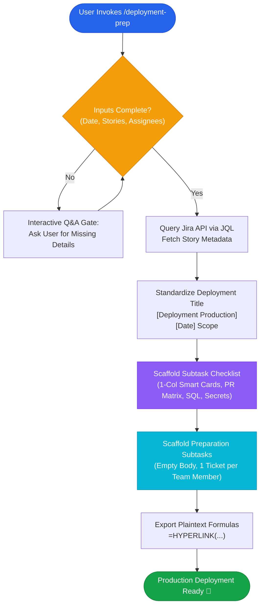

# lz-deployment-checklist-preparation

[](https://agentskills.io/specification)
[](../../LICENSE)
[](#the-research)

> Automated production deployment preparation and checklist scaffolder for Jira. Standardizes deployment ticket hierarchies, generates interactive rich-text checklist subtasks with 1-column inline Smart Card tables, scaffolds per-engineer preparation tickets without description clutter, and exports copy-paste Excel hyperlink formulas.

---

## Why This Skill?

Managing production deployments across microservices often suffers from:
1. **Inconsistent Ticket Titles:** Developers and release managers create tickets with differing naming formats, making board filtering and release auditing chaotic.
2. **Cluttered Checklist Descriptions:** Manually copy-pasting story titles and status lozenges results in stale, unreadable descriptions.
3. **Duplicate Checklist Bloat:** Creating preparation subtasks for team members that duplicate the entire checklist instead of maintaining a single source of truth.
4. **Tedious Release Sheet Tracking:** Manually linking Jira keys in sprint release spreadsheets.

`lz-deployment-checklist-preparation` solves this by introducing a **deterministic scaffolding protocol** designed specifically for Jira cloud and agile microservice releases.

---

## How It Works



---

## Core Features

### 1. Interactive Clarification Gate (Grill User With Questions)
The agent never assumes missing deployment parameters. It interactively prompts for:
* Target deployment date (e.g. `24 September 2026`).
* Stories to be bundled in the release.
* Parent deployment story.
* Checklist owner and preparation task assignees.

### 2. Standardized Naming Convention
Enforces a clean title structure across all related tickets:
* **Parent Story:** `[Deployment Production][<Date>] <Scope>`
* **Checklist Subtask:** `[Deployment Production][<Date>] Checklist - <Scope>`
* **Preparation Subtask:** `[Deployment Production][<Date>] Deployment Preparation - <Scope>`

### 3. 1-Column Inline Smart Card Stories Table
Eliminates redundant two-column story tables. Leverages Jira's Atlassian Document Format (`data-card-appearance="inline"`) to render live interactive chips with ticket status, summary, and priority automatically.

### 4. Zero-Clutter Preparation Subtasks
Automatically creates lightweight subtasks for each engineer assigned to the release with an empty description body, keeping the deployment checklist as the single source of truth.

### 5. Spreadsheet Hyperlink Generator
Directly outputs formatted formulas ready for copy-pasting into Google Sheets or Microsoft Excel:
```excel
=HYPERLINK("https://ict-siloamhospitals.atlassian.net/browse/KAIR-1422"; "KAIR-1422")
```

---

## The Research

| Source / Standard | Core Principle Applied |
| :--- | :--- |
| **Google SRE Book (2016)** | *Release Engineering & Production Readiness*: Standardized, reproducible release checklists reduce incident occurrence during rollout windows. |
| **DORA State of DevOps (2023)** | *Deployment Traceability*: Single-source-of-truth metadata linking code changes, database migrations, and release configuration directly to work items. |
| **Atlassian ADF Guidelines (2024)** | *Document Format Standardization*: Using inline card nodes (`inlineCard`) avoids payload duplication and guarantees reactive status updates. |

---

## Quick Start

Invoke in your agent conversation:

```bash
/skill:lz-deployment-checklist-preparation
```

Or ask naturally:
> *"Siapkan subtask checklist deployment production untuk rilis 24 September 2026 dengan story KAIR-1280, KAIR-1293, dan KAIR-1260 di bawah KAIR-1420."*

---

## License

MIT © [Lutfi Zain](https://github.com/lutfi-zain)
