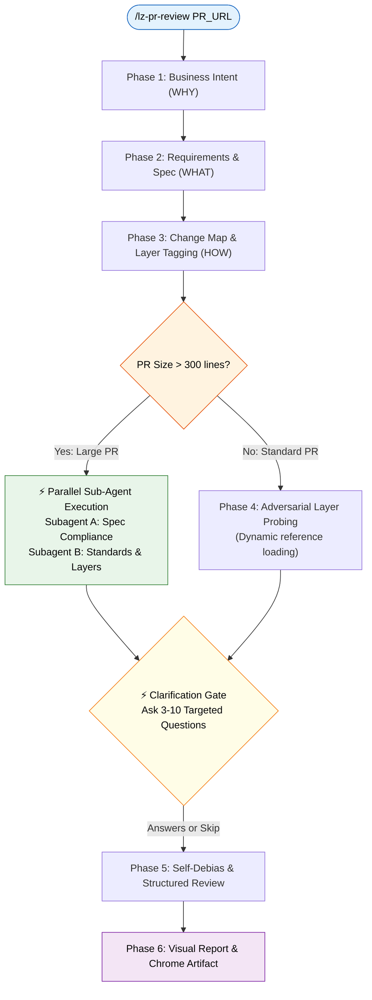

# lz-pr-review

[](https://agentskills.io/specification)
[](../../LICENSE)
[](#the-research)

> Company-grade six-phase pull request review with dynamic layer dispatching, adversarial invariant probing, and parallel sub-agents. Audits business intent, verifies requirements, detects scope creep, benchmarks against modular DB/Backend/Frontend/Architecture/Security standards, asks clarifying questions, and delivers a visual report.

---

## Why Another PR Review Skill?

Most PR review tools do one thing: read the diff and dump a list of superficial syntax complaints. Real Staff-level code reviews require:
1. **Understanding WHY the change exists** before evaluating HOW it was implemented.
2. **Preventing LLM Amnesia & Hallucination** through active adversarial invariant probing and the **Quote-Before-Accusing** evidence gate.
3. **Deep Stack-Specific Expertise** without token waste, loading specialized references (Database, Backend, Frontend, Architecture, Security) dynamically based on the layers touched.
4. **Context Isolation for Large PRs (>300 lines)** by delegating Spec Compliance and Engineering Standards to parallel sub-agents.

---

## How it Works



---

## What's Included

```
lz-pr-review/
├── SKILL.md                            # Orchestrator (6 phases + dispatcher + subagents)
├── README.md                           # Documentation, research citations, and guides
├── references/
│   ├── layer-database.md               # DB concurrency, lock timeouts, indexes, SARGable (db-*)
│   ├── layer-frontend.md               # UI waterfalls, context split, memoization, leaks (fe-*)
│   ├── layer-backend.md                # Outbound timeouts, retries, race conditions, outbox (be-*)
│   ├── layer-architecture.md           # Fowler code smells, leaky abstractions, boundaries (arch-*)
│   ├── layer-security.md               # OWASP ASVS, IDOR, SSRF, PII masking, secrets (sec-*)
│   ├── structural-remedies.md          # Named refactoring moves (Addy Osmani catalog)
│   ├── severity-guide.md               # Severity decision flowchart (Mermaid) & definitions
│   ├── anti-patterns.md                # 8 reviewer anti-patterns to avoid
│   └── review-checklist.md             # Master layer directory & universal sanity checks
├── scripts/
│   ├── pr-fetch.sh                     # Single-pass PR metadata + diff fetcher
│   └── pr-submit-review.sh             # GitHub review submitter
└── assets/
    ├── REVIEW_REPORT.md                # Report template with mermaid diagrams
    └── CLARIFICATION_QUESTIONS.md      # Question bank by category + PR size
```

---

## Modular Layer Rules

| Layer | Prefix | Canonical Sources | Focus Areas |
|---|---|---|---|
| **Database** | `db-` | PostgreSQL Wiki, Markus Winand, Supabase | DDL lock timeouts, batching deletions, non-SARGable predicates, missing FK indexes, Expand-Contract zero-downtime |
| **Frontend** | `fe-` | React.dev, Vercel Core, Web Vitals | Eliminating async waterfalls, context re-render splits, inline prop memoization, event listener cleanup, barrel imports |
| **Backend** | `be-` | Michael Nygard (*Release It!*), Sentry | Outbound client timeouts, exponential backoff with jitter, atomic updates vs races, goroutine leaks, Transactional Outbox |
| **Architecture** | `arch-` | Martin Fowler (*Refactoring*), SOLID | Primitive Obsession, Shotgun Surgery, Feature Envy, Leaky Abstractions, God Components |
| **Security** | `sec-` | OWASP Top 10, OWASP ASVS v4.0 | IDOR tenant isolation, SQLi, SSRF, secret exposure, unmasked PII logging, missing authentication gates |

---

## Severity Classification

| Emoji | Level | Definition | Action |
|-------|-------|-----------|--------|
| 🔴 | **BLOCKING** | Production incident, data corruption/loss, security breach, lock escalation | Must fix before merge |
| 🟠 | **IMPORTANT** | Quality regression, N+1 queries, missing tests, uncleaned subscriptions | Should fix before merge |
| 🟡 | **SUGGESTION** | Better architectural approach, readability improvement, minor optimization | Author's call |
| 🔵 | **NIT** | Style preference, formatting, naming | Optional |
| ⚪ | **QUESTION** | Needs clarification from author to evaluate | Response needed |

---

## The Research

| Source | Year | Canonical Contribution |
|--------|------|------------------------|
| [Google Engineering Practices](https://google.github.io/eng-practices/) | 2019 | Standard of code review; rigor on what to look for and when to approve |
| [Martin Fowler & Kent Beck — Refactoring](https://refactoring.com/catalog/) | 2018 | The 12 Code Smells baseline (Primitive Obsession, Shotgun Surgery, Feature Envy) |
| [PostgreSQL Community — Don't Do This](https://wiki.postgresql.org/wiki/Don't_Do_This) | 2024 | Critical database anti-patterns, lock escalation, and schema evolution risks |
| [Markus Winand — Use The Index, Luke!](https://use-the-index-luke.com/) | 2012 | SARGable query predicates, composite index order, and B-Tree execution mechanics |
| [React Core — You Might Not Need an Effect](https://react.dev/learn/you-might-not-need-an-effect) | 2023 | State reactivity, render-time computation, and lifecycle cleanup guarantees |
| [Vercel — react-best-practices](https://github.com/vercel-labs/agent-skills) | 2026 | 70-rule prioritized performance rubric with positive and negative code diffs |
| [Michael Nygard — Release It!](https://pragprog.com/titles/mnee2/release-it-second-edition/) | 2018 | Fail-fast patterns, circuit breakers, explicit client timeouts, and bulkhead isolation |
| [OWASP Foundation — ASVS v4.0](https://owasp.org/www-project-application-security-verification-standard/) | 2021 | Strict verification standards for IDOR, SSRF, injection, and PII protection |
| [Matt Pocock — code-review](https://github.com/mattpocock/skills) | 2026 | Dual-axis review (Spec vs Standards) running in parallel sub-agents |
| [Addy Osmani — code-review-and-quality](https://github.com/addyosmani/agent-skills) | 2026 | Structural Remedies catalog and mutation testing verification mindset |
| [Sadowski et al. — Modern Code Review at Google](https://dl.acm.org/doi/10.1145/3183519.3183525) | 2018 | Empirical evidence that reviews find architectural drift and intent mismatch over shallow syntax |

---

## License

MIT
