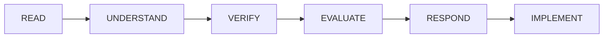

# PR Review Anti-Patterns — What NOT to Do (`anti-patterns.md`)

Extracted from real-world PR review failures across Google, Sentry, and production post-mortems.
Referenced when the reviewer evaluates its own findings before publishing.

---

## Anti-Pattern 1: The Rubber Stamp
- **What it looks like:** *"LGTM! 👍"*
- **Why it's harmful:** Misses critical production bugs, provides zero value to the author, erodes review accountability.
- **Correction:** Even if the PR is clean, cite specific things verified: *"LGTM — verified that the new order cancellation handles both 401 unauthenticated and concurrent refund states correctly."*

---

## Anti-Pattern 2: The Novel
- **What it looks like:** 50+ comments, multi-paragraph essays on trivial details.
- **Why it's harmful:** Overwhelms the author with review fatigue; critical blocking issues get drowned in noise.
- **Correction:** Escalate the top 3-5 high-leverage issues as BLOCKING/IMPORTANT. Group lower-priority suggestions into a follow-up ticket.

---

## Anti-Pattern 3: The Gatekeeper
- **What it looks like:** Blocking on personal syntax preferences ("I would have used a reduce instead of for...of").
- **Why it's harmful:** Demoralizes authors, slows down velocity without adding reliability or safety.
- **Correction:** If the code works, passes tests, and follows project conventions, approve it. Use `NIT` or `SUGGESTION` for preferences.

---

## Anti-Pattern 4: The Time Bomb
- **What it looks like:** Approving quickly without reading the diff ("I trust the author").
- **Why it's harmful:** This is how production outages happen.
- **Correction:** Always read the diff. For large PRs, prioritize critical paths (auth, payment, DB migrations).

---

## Anti-Pattern 5: The Ghost
- **What it looks like:** Starting a review, leaving 2 ambiguous comments, then disappearing for days without a verdict.
- **Why it's harmful:** Blocks the author and creates team uncertainty.
- **Correction:** Set expectations and always conclude with a definitive verdict (`APPROVE`, `REQUEST_CHANGES`, or `COMMENT`).

---

## Anti-Pattern 6: The False Positive Factory & Hallucinated Bug
- **What it looks like:** Making ungrounded claims ("This MIGHT cause a race condition") without citing specific code or verifying framework behavior.
- **Why it's harmful:** Wastes engineering time and causes reviewers to lose credibility.
- **Correction:** Enforce the **Quote-Before-Accusing** rule. Every claim must quote exact verbatim lines from the diff and explain the concrete mechanism of failure.

---

## Anti-Pattern 7: The Performative Agreement
- **Source:** `getsentry/skills` code-review (Sentry engineering practices)
- **What it looks like:** Blindly agreeing with any user objection without evaluating technical trade-offs.
- **Correction Protocol:**

Before agreeing, verify: Is the suggestion actually better? Does it apply to this context? Check actual codebase usage before adopting abstractions.

---

## Anti-Pattern 8: The Scope Creep
- **What it looks like:** *"While you're at it, could you also refactor the entire authentication system?"*
- **Why it's harmful:** Balloons PR size, delays deployment, and tangles unrelated changes making rollbacks difficult.
- **Correction:** Keep review focused strictly on the PR requirements. Create a separate Jira/GitHub issue for unrelated cleanups.
