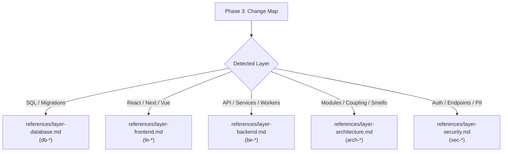

# Master Review Checklist & Layer Directory (`review-checklist.md`)

Master reference index for `lz-pr-review`. For deep-dive rules with negative and positive code examples, load the dedicated layer references.

---

## Modular Layer References

---

## 1. Quick Layer Routing

| Layer | Dedicated Reference File | Primary Focus | Key Prefixes |
|---|---|---|---|
| **Database** | `./references/layer-database.md` | DDL locks, batching, non-SARGable queries, N+1 queries, Expand-Contract zero-downtime, connection leaks | `db-lock-`, `db-sargable-`, `db-migr-`, `db-conn-` |
| **Frontend** | `./references/layer-frontend.md` | Async waterfalls, context split, re-render memoization, event listener cleanup, barrel imports, virtualization | `fe-waterfall-`, `fe-rerender-`, `fe-memory-`, `fe-bundle-` |
| **Backend** | `./references/layer-backend.md` | Explicit network timeouts, exponential backoff with jitter, concurrency races, goroutine leaks, error wrapping, Outbox pattern, idempotency | `be-timeout-`, `be-retry-`, `be-concurrency-`, `be-error-`, `be-outbox-` |
| **Architecture** | `./references/layer-architecture.md` | Fowler code smells (Primitive Obsession, Shotgun Surgery, Feature Envy), Leaky Abstractions, God Components, DTO boundaries | `arch-smell-`, `arch-boundary-`, `arch-coupling-` |
| **Security** | `./references/layer-security.md` | IDOR tenant checks, SQL injection, SSRF, secret hardcoding, PII logging masking, missing authentication middleware, mass assignment | `sec-authz-`, `sec-inject-`, `sec-leak-`, `sec-authn-` |

---

## 2. Universal Sanity Checklist (Every PR)

Regardless of stack or layer, verify these 5 universal criteria:

1. **Evidence Verification:** Every finding quotes exact verbatim remote GitHub lines (`file#L10-L15`).
2. **Secret Scan:** No `.env`, private keys, passwords, or test tokens committed.
3. **Rollback Safety:** Can this change be reverted cleanly without database corruption or orphan states?
4. **Test Quality:** Do tests verify actual business behavior, or are they testing mock implementation details?
5. **No Hallucinated Criticisms:** If a framework convention or external API behavior is questioned, verify via AST or documentation first.
