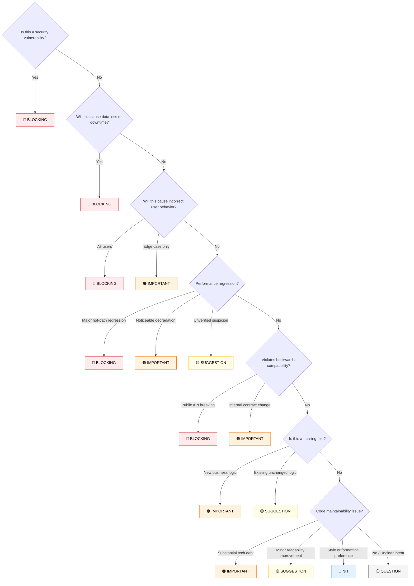

# Severity Classification Guide (`severity-guide.md`)

Detailed guide for consistently classifying PR review findings. Referenced during Phase 4-5 of the `lz-pr-review` workflow.

---

## Decision Flowchart

---

## Severity Definitions

### 🔴 BLOCKING
**Must fix before merge. Non-negotiable.**

Criteria (ANY one is sufficient):
- Security vulnerability (IDOR, SQL injection, SSRF, auth bypass, data leak)
- Data corruption, data loss, or unrecoverable state
- Production crash potential or connection pool starvation
- Broken backwards compatibility on public APIs or unmigrated DB columns
- Compliance violation (GDPR, HIPAA, PCI-DSS, secret exposure)
- Unbounded loops or missing timeouts on external service dependencies

### 🟠 IMPORTANT
**Should fix before merge. Exceptions require documented justification.**

Criteria:
- Significant performance regression (N+1 queries, unindexed foreign keys)
- Missing tests for new business logic
- Error handling that swallows root cause or leaks internal stack traces
- Cascading re-renders or uncleaned memory subscriptions in UI
- Technical debt that will compound quickly or violates clean boundaries

### 🟡 SUGGESTION
**Improvement opportunity. Author may accept or decline with reason.**

Criteria:
- Better architectural approach exists but current implementation is functionally safe
- Readability or simplification opportunity (applying named Structural Remedy)
- Pattern inconsistency with codebase conventions

### 🔵 NIT
**Style preference. Author's call.**

Criteria:
- Formatting preference (when not auto-enforced by linter)
- Import ordering
- Minor wording suggestions in comments or documentation

### ⚪ QUESTION
**Not a finding — needs clarification from author to evaluate.**

Criteria:
- Intent is ambiguous from PR description
- Unclear whether an apparent edge-case is mitigated upstream
- Needs confirmation on SLA or domain requirement

---

## Escalation Rules

1. If you have **$\ge$ 1 BLOCKING** finding $\rightarrow$ Verdict: `REQUEST_CHANGES`
2. If you have **$\ge$ 3 IMPORTANT** findings with no BLOCKING $\rightarrow$ Verdict: `REQUEST_CHANGES`
3. If you have **1-2 IMPORTANT** findings only $\rightarrow$ Verdict: `APPROVE` with conditional comments
4. If you have only **SUGGESTION + NIT** findings $\rightarrow$ Verdict: `APPROVE`
5. If you have only **QUESTION** findings $\rightarrow$ Verdict: `COMMENT` (pending clarification)
